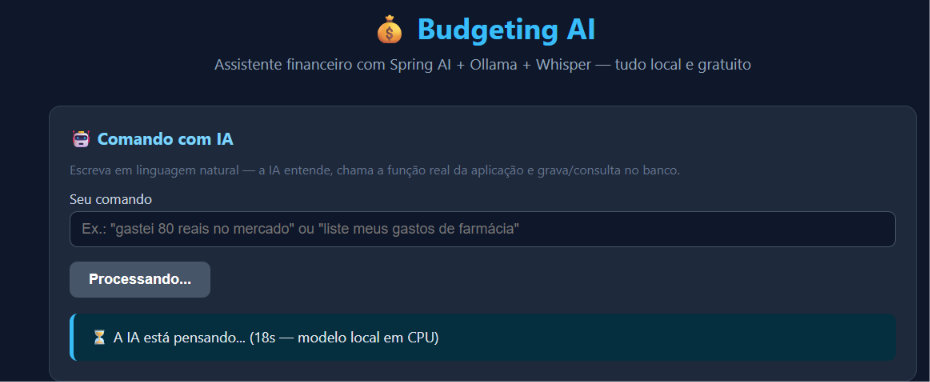

# Projeto Final — API Inteligente de Orçamento com Spring AI + Ollama

> Desafio de Projeto DIO: API de orçamento pessoal com **Spring Boot + Spring AI**, usando **Ollama** (modelos de linguagem **locais e gratuitos**) para entender comandos em linguagem natural e executar **funções reais** da aplicação via **Tool Calling** — tudo testável por uma **interface web simples**.

---

## 1. O que o projeto faz

A API de **budgeting** (orçamento pessoal) registra e consulta transações financeiras de duas formas:

1. **Interface web / REST tradicional** — formulário e filtros que chamam endpoints JSON;
2. **Comando de VOZ ou texto com IA** — você grava um áudio (ou escreve) *"gastei 80 reais no mercado"* e:
   - um **Whisper local** transcreve o áudio em texto;
   - o modelo local (Ollama) entende a intenção;
   - ele chama a **ferramenta** (`@Tool`) correta — que é um **caso de uso real** da aplicação;
   - grava ou consulta os dados no banco;
   - responde em texto, em português.

**Diferencial desta versão:** nenhuma chave de API paga é necessária — o modelo roda 100% local via Ollama.

---

## 2. Fluxo principal da API

```
┌────────────────────┐          ┌──────────────────────────┐
│ Interface web      │  áudio   │ POST /transactions/ai/   │
│ (microfone/arquivo)│ ───────► │ audio → Whisper local    │
│                    │          │ transcreve p/ texto      │
│                    │  texto   │                          │
│                    │ ───────► │ POST /transactions/ai    │
└────────────────────┘  202 +   │ cria o job e responde já │
                        jobId   └───────────┬──────────────┘
                                            ▼ (2º plano)
                          1. ChatClient + system prompt
                             (modelo local via Ollama)
                                      ▼
                          2. Tool Calling (@Tool)
                             escolhe o caso de uso real:
                             persist-transaction |
                             list-transactions-by-category |
                             list-all-transactions
                                      ▼
                          3. Repositório do domínio
                             JPA ──► MySQL
                                      ▼
┌────────────────────┐ polling  ┌──────────────────────────┐
│ GET /ai/{jobId}    │ ◄──────► │ job: PROCESSING → DONE   │
│ (resposta em texto)│          │ AiJobResponse { reply }  │
└────────────────────┘          └──────────────────────────┘
```

**E o áudio?** O Ollama não transcreve áudio, então a transcrição ficou com um **Whisper local** (container **whisper.cpp**, ~150 MB, gratuito) — áudio → texto → Ollama, como no projeto original. A única etapa do fluxo original que ficou de fora é a **TTS** (resposta em voz), que exigiria mais um serviço; a resposta final é em texto.

**E por que assíncrono?** O Ollama roda em CPU, então um comando de IA pode levar de 1 a 5 minutos. Se a requisição ficasse aberta esperando, proxies intermediários (como o do GitHub Codespaces) cortariam a conexão com erro **504**. Por isso o `POST /transactions/ai` devolve **202 Accepted** com um `jobId` imediatamente, e o resultado é consultado em `GET /transactions/ai/{jobId}`.

---

## 3. Arquitetura (camadas DDD)

```
dio.budgeting
├── domain/                     # negócio puro (sem framework)
│   ├── Transaction.java               # entidade (class: tem identidade)
│   ├── TransactionId.java             # ID fortemente tipado (record + UUID)
│   ├── Category.java                  # enum: GROCERIES, PHARMA, AUTO
│   └── TransactionRepository.java     # contrato de persistência
│
├── application/                # casos de uso = ferramentas da IA
│   ├── PersistTransactionUseCase.java         # @Tool "persist-transaction"
│   ├── ListTransactionsByCategoryUseCase.java # @Tool "list-transactions-by-category"
│   ├── ListAllTransactionsUseCase.java        # @Tool "list-all-transactions" (NOVO)
│   ├── AiActionRecorder.java                  # auditoria: registra o que a ferramenta executou (NOVO)
│   ├── input/PersistTransactionInput.java     # DTO de entrada (@ToolParam)
│   └── output/TransactionOutput.java          # DTO de saída
│
└── infrastructure/             # adapters (HTTP, JPA, IA)
    ├── http/TransactionController.java        # REST + endpoints /ai e /ai/audio (assíncrono)
    ├── http/ai/AiJobService.java              # jobs da IA em 2º plano + ChatClient
    ├── ai/WhisperTranscriptionService.java    # transcrição de áudio (Whisper local)
    ├── http/request/                          # TransactionRequest, AiRequest
    ├── http/response/                         # TransactionResponse, AiJobResponse
    └── persistence/                           # TransactionEntity (JPA),
                                               # TransactionEntityRepository (Spring Data),
                                               # JpaTransactionRepository (adapter)
```

**Ponto-chave:** os mesmos casos de uso atendem **o REST e a IA** — a anotação `@Tool` expõe a regra de negócio ao modelo sem duplicar código.

---

## 4. Tecnologias utilizadas

| Tecnologia | Papel |
|---|---|
| Java 25 | Linguagem (com *virtual threads* para os jobs de IA) |
| Spring Boot 4.0.5 | Web, Data JPA, Docker Compose |
| Spring AI 2.0.0-M4 | `ChatClient` + Tool Calling |
| **Ollama + llama3.2:1b** | Modelo de linguagem **local e gratuito** |
| **Whisper local (whisper.cpp, modelo `base`)** | Transcrição de áudio gratuita (container Docker) |
| MySQL 9.6 | Persistência (sobe via `compose.yml`) |
| H2 | Banco em memória apenas para os testes |
| HTML + CSS + JS (vanilla) | Interface web de testes (servida em `/`) |
| Lombok / JUnit 5 | Boilerplate / testes |

---

## 5. Como executar a aplicação

**Pré-requisitos:** Java 25 e Docker rodando.

```bash
# 1. Suba a infraestrutura (MySQL + Ollama + Whisper):
docker compose up -d

# 2. Baixe os modelos de IA (só na 1ª vez; ~1,3 GB + ~148 MB):
docker exec projetofinal-ollama-1 ollama pull llama3.2:1b
docker run --rm -v whisper_models:/models alpine wget -q -O /models/ggml-base.bin \
  https://huggingface.co/ggerganov/whisper.cpp/resolve/main/ggml-base.bin
# (com RAM sobrando, o modelo "small" transcreve melhor: troque base→small aqui e no compose.yml)

# 3. Rode a aplicação (este terminal fica ocupado — é o servidor):
./gradlew bootRun
```

> ⚠️ **Ordem importa:** o `bootRun` é um servidor — ele nunca "termina" (a barra do Gradle fica parada em `83% EXECUTING`, é **normal**!). Rode os downloads **antes** ou em **outro terminal**.

> **Alternativa sem Docker para a IA:** instale o Ollama na máquina (<https://ollama.com>), rode `ollama pull llama3.2:1b` e depois `ollama serve`. O `compose.yml` continua cuidando do MySQL e do Whisper.

**Acesse a interface web:** <http://localhost:8080>

Configurações da IA em `src/main/resources/application.properties`:

```properties
spring.ai.ollama.base-url=http://localhost:11434
spring.ai.ollama.chat.options.model=llama3.2:1b
spring.ai.ollama.chat.options.temperature=0
spring.ai.ollama.chat.options.num-ctx=2048               # contexto menor = menos RAM
spring.ai.ollama.init.pull-model-strategy=WHEN_MISSING   # tenta baixar o modelo sozinho
app.whisper.base-url=http://localhost:9030               # Whisper local (transcrição de áudio)
spring.ai.http.client.read-timeout=10m                   # inferência em CPU pode demorar
```

---

## 6. Como testar o fluxo principal

### Pela interface web (recomendado)

1. Abra <http://localhost:8080>;
2. **Comando por áudio (fluxo principal):** clique em *🎙️ Gravar*, fale `gastei 80 reais no mercado` e depois *Parar e enviar* — a página mostra a **transcrição** (Whisper) e depois a resposta da IA (em CPU pode levar 1–3 minutos);
3. **Comando por texto:** mesma ideia, digitando;
4. **Consultar:** clique em *Listar todas* e confirme que o registro aparece (prova de que o Tool Calling executou o caso de uso real);
5. Teste também: `liste meus gastos de farmácia`, `quais foram todas as minhas transações?`;
6. Use o formulário REST para comparar o cadastro manual com o cadastro via IA.

### Pelo terminal (curl)

```bash
# Comando com IA por ÁUDIO (Whisper transcreve + IA processa; o reply inicial é a transcrição)
curl -X POST http://localhost:8080/transactions/ai/audio \
  -F "file=@comando.m4a"
# => {"jobId":"a1b2...","status":"PROCESSING","reply":"gastei 80 reais no mercado"}

# Comando com IA por texto (assíncrono): cria o job e já retorna 202 + jobId
curl -X POST http://localhost:8080/transactions/ai \
  -H "Content-Type: application/json" \
  -d '{"message":"paguei 45 reais de remédio na farmácia"}'
# => {"jobId":"c1d2...","status":"PROCESSING","reply":null}

# Acompanhe o job até status DONE
curl http://localhost:8080/transactions/ai/c1d2...
# => {"jobId":"c1d2...","status":"DONE","reply":"Transação registrada! ..."}

# Criar transação via REST (valor em centavos)
curl -X POST http://localhost:8080/transactions \
  -H "Content-Type: application/json" \
  -d '{"description":"Mercado","category":"GROCERIES","amount":8000}'

# Consultas
curl http://localhost:8080/transactions            # todas (NOVO)
curl http://localhost:8080/transactions/PHARMA     # por categoria
```

### Testes automatizados

```bash
./gradlew test   # usa H2 em memória; não precisa de Docker nem de Ollama
```

---

## 7. Melhorias implementadas nesta versão

1. **Migração OpenAI → Ollama + Whisper local** — IA 100% local e gratuita (chat, tool calling **e transcrição de áudio**), sem chave de API nem custo por chamada. Arquivos: [build.gradle](build.gradle), [application.properties](src/main/resources/application.properties), [compose.yml](compose.yml), [WhisperTranscriptionService.java](src/main/java/dio/budgeting/infrastructure/ai/WhisperTranscriptionService.java);
2. **Interface web em HTML/CSS/JS** para testar todas as funcionalidades: [index.html](src/main/resources/static/index.html);
3. **Nova ferramenta e endpoint "listar todas as transações"** — [ListAllTransactionsUseCase.java](src/main/java/dio/budgeting/application/ListAllTransactionsUseCase.java) + `GET /transactions`, permitindo perguntar à IA *"quais foram todos os meus gastos?"*;
4. **System prompt aprimorado** com regras explícitas (valor em reais, categorias disponíveis, tolerância a erros de transcrição, respostas curtas em PT-BR): [system-message.st](src/main/resources/prompts/system-message.st);
5. **Endpoint de IA assíncrono (202 + polling)** — a IA processa em segundo plano com *virtual threads* e a interface consulta o resultado, evitando o erro 504 de proxies quando o modelo local demora; as chamadas à IA são **serializadas** (uma por vez) para não derrubar o modelo em CPUs fracas: [AiJobService.java](src/main/java/dio/budgeting/infrastructure/http/ai/AiJobService.java);
6. **Ferramenta à prova de modelo pequeno** — parâmetros simples, validação com mensagens em texto (o modelo recebe o erro e pode corrigir sozinho) e retorno em linguagem natural: [PersistTransactionUseCase.java](src/main/java/dio/budgeting/application/PersistTransactionUseCase.java);
7. **Resposta auditável** — a resposta final é montada no backend a partir do que a ferramenta REALMENTE executou (não do texto improvisado pelo modelo), via [AiActionRecorder.java](src/main/java/dio/budgeting/application/AiActionRecorder.java). Assim a interface nunca mostra JSON cru nem valores errados;
8. **Vários gastos em um comando** — *"gastei R$30 no posto e R$5 no café"* é separado no backend ([AiJobService.java](src/main/java/dio/budgeting/infrastructure/http/ai/AiJobService.java)) e a ferramenta roda uma vez por gasto; se um trecho não for entendido, a resposta lista o que foi gravado e avisa o que ficou de fora;
9. **A conta fica com o backend, não com o modelo** — a ferramenta recebe o valor em **reais** e converte para centavos, e a descrição é limpa (tira o verbo e o valor que modelos de 1B repetem). Coberto por [PersistTransactionUseCaseTest.java](src/test/java/dio/budgeting/application/PersistTransactionUseCaseTest.java).


---

## 8. Solução de problemas

| Sintoma | Causa provável | Solução |
|---|---|---|
| Interface abre, mas a IA dá **504** | Proxy (ex.: Codespaces) cortou a espera longa | Já resolvido pelo fluxo assíncrono (202 + polling) |
| Ollama responde **500** / `llama-server ... signal: terminated` | Memória insuficiente para carregar o modelo | Use o `llama3.2:1b` (padrão deste projeto, ~1,3 GB). Modelos 3B exigem ~2,6 GB de RAM livre |
| IA muito lenta | Inferência em CPU | Normal na 1ª chamada (modelo carrega na RAM). Com mais RAM/GPU, troque o modelo em `spring.ai.ollama.chat.options.model` |
| Falha na transcrição do áudio | Whisper não subiu ou modelo não foi baixado | Rode o passo 3 de "Como executar"; veja `docker logs projetofinal-whisper-1` |
| `Connection refused` no 11434 | Ollama não subiu | `docker ps` e `docker logs projetofinal-ollama-1` |
| Resposta da IA sem gravar no banco | Modelo não chamou a ferramenta | Refaça o comando sendo explícito: *"registre um gasto de 80 reais no mercado"* |
| IA respondeu com **JSON/código** | Modelo 1B despejou a chamada da ferramenta como texto | O backend já trata: tenta de novo e, se persistir, responde de forma amigável pedindo para repetir o comando |
| IA demora vários minutos / Ollama 500 após muito tempo | Chamadas de IA em paralelo disputando CPU/RAM | Já mitigado: o backend processa **uma chamada de IA por vez** (fila); aguarde a resposta atual antes de enviar outra |
| Tela fica em "A IA está pensando..." por 10+ minutos | Modelo grande demais: o Ollama mata o `llama-server` por falta de RAM (`signal: terminated` em `docker logs projetofinal-ollama-1`) | Use `llama3.2:1b`. Testado: `qwen2.5:3b` é morto em ambiente de ~8 GB e as tentativas automáticas fazem parecer travamento |
| Uma chamada isolada levou ~4 min (as demais, 7–26 s) | Não diagnosticado; provável disputa de CPU (2 núcleos) | Medido uma vez em `docker logs projetofinal-ollama-1`. Aguarde; a interface continua consultando o resultado |
| Comando com 2 gastos grava só um | O modelo não entendeu um dos trechos | A resposta lista o que foi gravado e o que ficou de fora ("⚠️ Não entendi"); reenvie só o trecho faltante |
| `No space left on device` / `application.properties` vazio | Disco cheio durante o download de um modelo truncou arquivos | `df -h /`, apague modelos não usados (`ollama rm <modelo>`) e recrie o arquivo |

---

## 9. O que aprendi durante o desafio

- **Tool Calling é a ponte IA ↔ negócio:** o modelo decide *qual* ferramenta chamar e *com quais parâmetros*, mas quem executa a regra é o caso de uso — a IA não inventa dados;
- **Arquitetura em camadas vale ouro:** trocar OpenAI por Ollama mexeu só em `build.gradle` + `application.properties`. Domínio e casos de uso ficaram intactos;
- **Prompt engineering importa:** especificar centavos, categorias e formato de resposta no *system message* melhora muito a precisão do modelo local;
- **IA local tem limites de hardware:** o `qwen2.5:3b` foi morto por falta de RAM (a tela ficou 20 minutos "pensando" porque o Spring AI repetia a chamada) — o `llama3.2:1b` cabe e responde em segundos;
- **Modelos pequenos oscilam no Tool Calling:** testei `qwen2.5:1.5b` e `llama3.2:1b` — às vezes eles "comentam" o texto em vez de chamar a ferramenta. O que aumentou o acerto: prompt com exemplos + parâmetros simples nas ferramentas + mensagens de validação em texto (o modelo recebe o erro e pode corrigir sozinho);
- **Áudio sem OpenAI:** um Whisper local em Docker substituiu o Whisper pago, mantendo o fluxo áudio → texto → IA do projeto original;

---

## 10. Evidências

<!-- Prints da interface, respostas da IA, saída dos testes... -->

Interface web com um comando de IA registrado e a resposta auditável:

